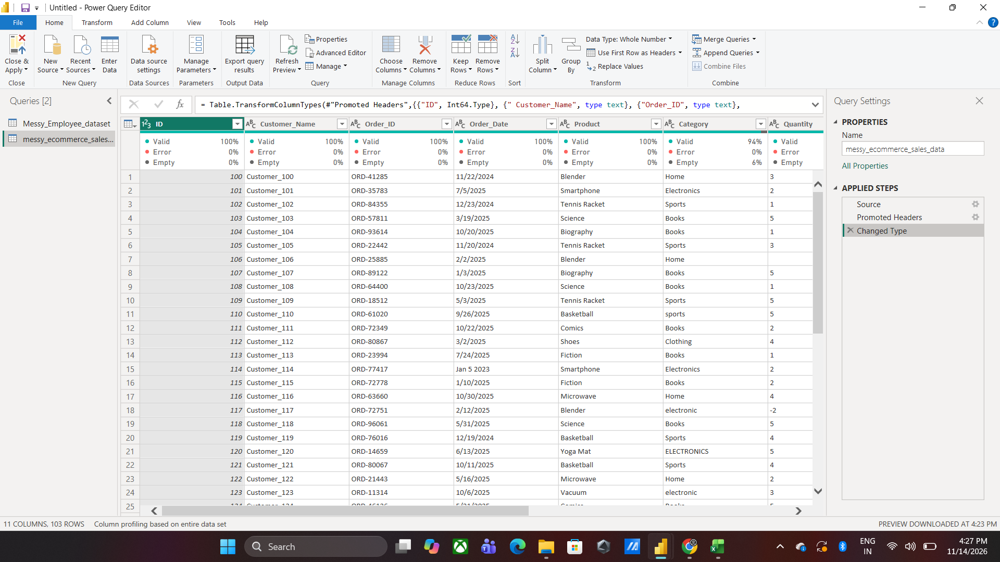

# sales_analysis

Cleaning and analysing a messy e-commerce sales dataset using **Power Query** and **DAX** (Power BI).

## Dataset Overview

The raw dataset contains order-level sales records with the following columns:

| Column | Description |
|---|---|
| ID | Record identifier |
| Customer_Name | Name of the customer |
| Order_ID | Order identifier |
| Order_Date | Date the order was placed |
| Product | Product name |
| Category | Product category |
| Quantity | Number of units ordered |
| Price | Price per unit |
| Payment_Method | How the customer paid |
| Status | Order status |
| Total | Order total (as recorded in the raw data) |

## Initial Observation

The dataset is **messy** and needs cleaning before any analysis can be done. The issues found and the fixes applied are documented step by step below.

*Raw data as loaded into Power Query, before any cleaning.*

## Data Cleaning Log

*(To be filled in as the cleaning progresses.)*
